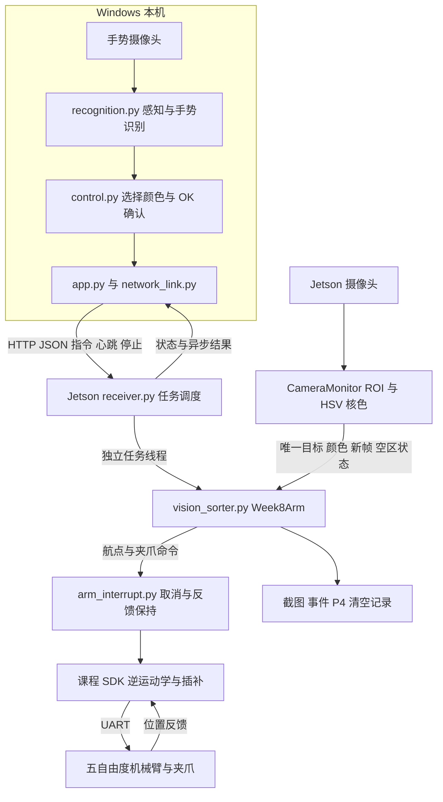
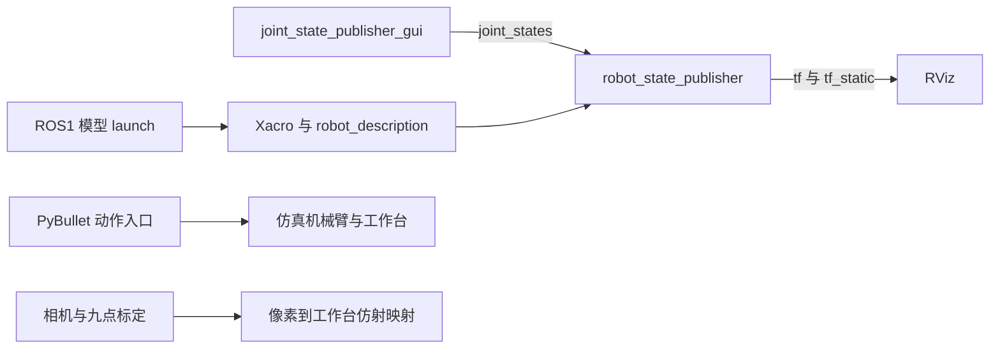
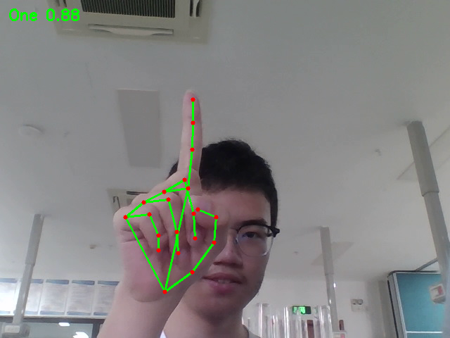

# Robot — 机器人感知与控制综合实践

本项目面向杭州电子科技大学《机器人感知与控制综合实践》课程，以机械臂目标识别与手势搬运为主题，实现摄像头感知、HSV 颜色识别、手势决策与机械臂抓放的软件处理链。仓库包含五自由度实机 SDK、固定点分拣与手势选色程序、PyBullet 仿真，以及独立的 ROS1 机械臂建模工程。

## 1. 项目简介

课程方向为“机械臂目标识别与手势搬运综合系统的开发”，课程代码为 `S0610350`，学期为 `2026–2027` 学年第一学期。具体教学班代码 `(2026-2027-1)-S0610350-01/2/3/4`、组号及成员信息待填写。

综合实践主要代码位于 [目标识别目录](5.目标识别/)、[Week7](week7/) 和 [ROS 工作空间](arm2026_ws/)。Week6 实现固定 P4 点自动颜色分拣；Week7 实现手势动作控制；Week8 串联“手势选色—Jetson 核色—固定 P4 抓放”。关节控制、正逆运动学和夹爪操作使用课程设备 Python SDK。

现有集成方式为 **Windows 本机识别 + Jetson 接收与执行 + HTTP/JSON 通信**。ROS1 工程负责 URDF/Xacro、关节状态与 TF 可视化；摄像头和综合算法尚未接入课程工程的 ROS 话题，也没有整套感知与控制的一键 launch。Week8 软件调用链已具备，真实识别准确率、逐色抓放与制停表现仍待现场验证。

本文依据课程任务书、报告模板、源码、依赖清单和已有记录整理，核对日期为 **2026-11-10**。状态定义：**已实现**表示已有对应代码逻辑；**部分实现**表示仍缺少要求中的组件；**待验证**表示缺少对应运行或现场证据；**未实现**表示课程工程中无对应实现。

## 2. 项目功能

| 功能模块 | 核心技术 | 代码位置 | 完成状态 |
| --- | --- | --- | --- |
| 机械臂关节与夹爪控制 | UART、角度线性映射、关节限位 | [arm5dof_uservo.py](arm5dof_python_uservo/arm5dof_uservo.py)、[uservo.py](arm5dof_python_uservo/uservo.py) | 已实现 |
| 末端定位与航点执行 | DH 正运动学、解析 IK、最小 jerk 插补 | [arm5dof_kinematic.py](arm5dof_python_uservo/arm5dof_kinematic.py)、[minimum_jerk.py](arm5dof_python_uservo/minimum_jerk.py) | 已实现 |
| HSV 四色识别与像素中心 | 双区间红色阈值、开闭运算、轮廓、ROI | [sorting_core.py](5.目标识别/week6_p4/sorting_core.py)、[vision_sorter.py](5.目标识别/week8/vision_sorter.py) | 已实现 |
| 图像到工作台坐标转换 | 内参标定、PnP、已知高度平面仿射映射 | [image2workspace.py](arm5dof_visual_grasping/image2workspace.py) | 已实现 |
| 固定 P4 自动分拣 | 稳定帧确认、抓放序列、空区重置 | [week6_p4](5.目标识别/week6_p4/) | 部分实现 |
| 手势动作交互 | MediaPipe、关键点几何、状态机、HTTP | [Week7 控制器](week7/gesture_usb/control.py)、[接收端](week7/gesture_usb/receiver_usb.py) | 已实现 |
| 手势选色搬运 | 本机选色、Jetson 核色与 P4 抓放 | [Week8](5.目标识别/week8/) | 待验证 |
| PyBullet 仿真 | 航点运动、场景、物块确定性绑定 | [仿真入口](arm5dof_python_pybullet/run_real_examples_in_sim.py) | 已实现 |
| ROS 建模与可视化 | ROS1 Noetic、catkin、Xacro、RViz | [marm_description](arm2026_ws/src/marm_description/) | 已实现 |
| ROS 感知与控制集成 | 图像话题、实机关节桥接、总 launch | [现有 launch](arm2026_ws/src/marm_description/launch/) | 部分实现 |
| ROS2 应用、MoveIt 避障 | ROS2 节点、规划器集成 | 课程源码无对应实现，`_reference` 为第三方资料 | 未实现 |

任务书要求图像话题、实机关节状态以及模型/摄像头/算法的一键启动，这些是当前优先补齐项。任务书未限定必须使用 ROS2，现有工作空间按 ROS1 Noetic 编译。

完成度说明：Week6 的演练和逻辑测试通过，真机仍缺标定确认和桶位 Roll；Week7 有硬件动作回执，随机手势及中断验收待补；Week8 调用链和 21 项离线测试已具备，现场抓放待验证；ROS 具有历史可视化运行记录，当前环境仍需复现。旧标定模块的独立入口问题见第 9 节。

## 3. 项目目录结构

下列路径由实际文件清单筛选，省略环境、缓存、构建产物、重复解压副本和大型参考资源。

```text
robot/
├── README.md
├── 1.基础实验/                          # 基础：按键、OLED、舵机
├── 2.机械臂实验/                        # 基础：运动与搬运 Notebook
├── 3.AI基础图像处理/                    # 基础：OpenCV、摄像头
├── 4.机械臂OpenCV视觉处理实验/           # 标定、追踪、课程 SDK
│   ├── arm5dof_uservo.py
│   ├── config/
│   └── 计算相机坐标系到工作台坐标系的空间变换.ipynb
├── 5.sensor传感器模块/                  # 拓展基础：传感器
├── 5.目标识别/                          # 综合实践主要目录
│   ├── week5.ipynb                      # 颜色识别与取证入口
│   ├── week5_test_records.csv
│   ├── evidence/
│   ├── week3/                          # 定点搬运材料
│   ├── week4/                          # 堆叠材料
│   ├── gesture_pc/                     # 较早手势版本
│   ├── gesture_usb/                    # USB 网络版源程序
│   ├── week6_p4/
│   │   ├── week6_color_sorting.ipynb    # 分拣交互入口
│   │   ├── week6_color_sorting.py
│   │   ├── sorting_core.py
│   │   ├── hardware_backend.py
│   │   ├── bin_map.json
│   │   └── test_week6.py
│   └── week8/
│       ├── app.py                      # 本机手势选色入口
│       ├── receiver.py                 # Jetson 真机入口
│       ├── control.py
│       ├── recognition.py
│       ├── vision_sorter.py
│       ├── arm_interrupt.py
│       ├── week8_settings.py
│       ├── week8_laptop.ipynb          # 本机独立 Notebook
│       ├── week8_jetson.ipynb          # Jetson 独立 Notebook
│       ├── requirements_laptop.txt
│       └── test_week8.py
├── week7/                              # 实验七独立分发目录
│   ├── week7_gesture_control.py         # 本机入口
│   ├── requirements_windows.txt
│   ├── gesture_usb/
│   │   ├── receiver_usb.py             # Jetson 接收入口
│   │   ├── control.py
│   │   └── test_usb.py
│   ├── models/gesture_recognizer.task
│   └── records/                        # 动作回执与人工记录模板
├── arm5dof_python_uservo/               # 实机 SDK，依赖配置与设备
│   ├── arm5dof_uservo.py
│   ├── arm5dof_kinematic.py
│   ├── arm_application.py
│   └── config/
├── arm5dof_python_pybullet/              # 独立仿真，读取相邻 SDK 配置
│   ├── run_real_examples_in_sim.py
│   ├── real_scene.py
│   └── requirements-sim.txt
├── arm5dof_visual_grasping/              # 视觉抓取基础，旧入口需适配
│   ├── camera_calibration.py
│   ├── image2workspace.py
│   ├── grab_color_block.py
│   └── vconfig/
├── arm2026_ws/                          # 独立 ROS1 建模工程
│   ├── src/marm_description/
│   │   ├── package.xml
│   │   ├── CMakeLists.txt
│   │   ├── urdf/marm_z1_style_core.xacro
│   │   └── launch/view_marm_z1_style.launch
│   ├── generated/                      # URDF 与验证记录
│   └── report_assets/                  # 建模素材
├── 6.AI听觉综合项目/                    # 拓展语音，未接入综合链
├── AI视觉综合项目（旧）/                # 历史参考
├── hello_world.py                      # 基础示例
├── week6 (1).ipynb                      # 早期分拣入口，默认真机
├── week6_vision_garbage_sorting_week3 (1).ipynb  # 分拣研究版本
└── week7_package_builder_20261026.py     # 打包维护工具，含本机路径
```

原始工作区 `D:\robot` 的目标识别目录名为 `5.目标识别(已修改)`，GitHub 发布版统一为 `5.目标识别`。原始工作区另有 `week6_fix_tmp/build_repaired.py` 与 `test_repaired.py`，用于生成和测试修复 Notebook，依赖本机下载路径，未纳入发布版。根目录两个 Week6 Notebook 的默认模式、位姿处理不同，建议综合实验使用下文指定版本。

基础实验、传感器与语音模块提供课程学习材料，不计作最终手势搬运系统的集成成果。`arm2026_ws/_reference/` 是第三方参考副本，`_backup/` 是历史备份，模型当前源码以 `src/marm_description/` 为准。

## 4. 系统总体架构

### 4.1 Week8 已实现的软件数据流

箭头表示源码中的数据或调用方向，真实硬件闭环效果待现场验收。



感知层提供手势关键点和 Jetson 新鲜图像；识别层输出手势类别、颜色及像素中心；决策层负责候选确认、互斥和重置；运动层将预设位姿转换为关节轨迹；硬件层通过六个串口舵机控制五个机械臂关节及夹爪。Week8 的像素中心用于检查与显示，抓取采用固定 P4 位姿，不执行任意像素到抓取点的在线映射。

### 4.2 独立实验模块



ROS、PyBullet 和九点标定为独立模块。当前未将五自由度实机 SDK 与 ROS 六旋转关节模型进行驱动映射；模型关节数量不能直接作为实机自由度。

## 5. 开发与运行环境

| 环境项目 | 已确认版本或配置 | 依据 |
| --- | --- | --- |
| 本机系统 / Python | Windows、64 位 Python 3.11 | Week7 安装脚本和启动器 |
| 本机 OpenCV / NumPy | `opencv-contrib-python==4.11.0.86`、`numpy==1.26.4` | Week7 / Week8 requirements |
| 手势与其他依赖 | MediaPipe `0.10.21`、pyserial `3.5`、JAX/JAXlib `0.4.35`、SciPy `1.14.1`、Pillow `>=10,<14` | [本机依赖](5.目标识别/week8/requirements_laptop.txt) |
| Jetson | 配置注释指向 Jetson Nano，默认 `/dev/ttyTHS1`；实际型号、系统及 JetPack 版本待填写 | SDK `config.py` |
| Jetson Python | 沿用课程 SDK 环境；Week6 有 Python 3.6 语法检查记录，现场解释器版本待填写 | [离线记录](5.目标识别/week6_p4/verification/offline_verification.json) |
| Jetson 图像/面板依赖 | NumPy、OpenCV、pyserial；Notebook 另需 ipywidgets、IPython/Jupyter | 实际 import，无统一 Jetson 锁定清单 |
| ROS 环境 | ROS1 Noetic / catkin；历史运行使用 WSL2 Ubuntu 20.04 + WSLg | [运行记录](arm2026_ws/generated/rviz_validation.md) |
| ROS2 | 未发现课程自研 ROS2 包、节点或 colcon 工作空间 | `arm2026_ws/src` 与构建配置 |
| PyBullet | `pybullet==3.2.7`、`numpy>=1.19`，Python 小版本未锁定 | [requirements-sim.txt](arm5dof_python_pybullet/requirements-sim.txt) |
| 机械臂 | 五个机械臂关节 + 夹爪，六个舵机 ID `0..5`；商品型号待填写 | SDK 映射和适配层检查 |
| 控制接口 | UART `115200`、8 数据位、无校验、1 停止位；关节用弧度、SDK 位置用 mm | `Arm5DoFUServo.__init__`、运动学代码 |
| 摄像头 | `cv2.VideoCapture` 获取彩色图像，综合程序默认设备 `0`；品牌型号待填写 | `CameraMonitor.read`；旧 SDK 注释不能确认现场深度相机型号 |

本机依赖安装在同一解释器中，避免混装不同 OpenCV 发行包。Jetson 沿用设备匹配的 SDK 环境。本项目分别使用 ROS1 `catkin_make/roslaunch`、普通 Python 脚本和 Jupyter Notebook，现有综合应用不使用 `ros2 run` 或 `colcon build`。

## 6. 安装与启动

以下路径和参数已核对源码。**离线测试已通过**；新电脑安装、Jetson 真机启动及当前 ROS 图形环境复现均为**待验证**。每组命令标明执行位置、用途与预期结果。

### 6.1 获取代码

**位置：**任意开发目录。**作用：**下载并进入仓库。**预期：**出现上述主要目录；私有仓库需配置具有访问权限的 GitHub 凭据。

```bash
git clone https://github.com/Frankie417/robot.git
cd robot
```

不需要同时启动所有实验。先运行离线测试，再选 Week6 自动分拣、Week7 动作交互或 Week8 选色搬运。

### 6.2 Windows 本机依赖与识别界面

**位置：**仓库根目录 PowerShell。**作用：**建立 Week8 环境、安装依赖、启动本机识别窗口。**预期：**显示 Tk 界面，启动摄像头后出现手势标注；首次全新安装及现场取帧**待验证**。

```powershell
cd "5.目标识别/week8"
py -3.11 -m venv .venv
.\.venv\Scripts\python.exe -m pip install -r requirements_laptop.txt
.\.venv\Scripts\python.exe app.py
```

**Week7 替代入口：**从仓库根目录另开 PowerShell；作用为安装并启动动作交互版，预期 One/Two/Three 形成候选、OK 确认、Five 请求停止，现场测试**待验证**。

```powershell
cd week7
py -3.11 -m venv .venv-gesture
.\.venv-gesture\Scripts\python.exe -m pip install -r requirements_windows.txt
.\.venv-gesture\Scripts\python.exe week7_gesture_control.py
```

模型随目录保存于 `models/gesture_recognizer.task`。两版分别启动，Five 含义不同。

### 6.3 Jetson 硬件与摄像头

**位置：**Jetson 终端。**作用：**确认解释器、依赖和设备文件。**预期：**打印 Python/OpenCV/NumPy/pyserial 版本，列出串口与相机；现场执行**待验证**。

```bash
python3 --version
python3 -c "import cv2, numpy, serial; print(cv2.__version__, numpy.__version__, serial.__version__)"
ls -l /dev/ttyTHS1 /dev/video0
```

Week8 模块版修改 [week8_settings.py](5.目标识别/week8/week8_settings.py)；Week6 修改 [bin_map.json](5.目标识别/week6_p4/bin_map.json)。SDK 目录需同时包含配套 `.py` 与 `config/`，不能只复制单个 SDK 文件。

| 参数 | 当前源码值 | 使用要求 |
| --- | --- | --- |
| SDK 路径 / 内部 UART | `/home/jetson/Notebook/4.机械臂OpenCV视觉处理实验` / `/dev/ttyTHS1` | 与实际设备核对 |
| Week8 相机 / ROI | `0` / `(240,210,440,390)` | ROI 为 `x1,y1,x2,y2`，必须位于真实画面内 |
| Week8 最小轮廓面积 | `700` | 像素面积，结合物块距离调试 |
| Week8 P4 抓取 / 上方 | `(200.2,-12.8,45.0)` / `(198.2,-12.8,75.0)` mm | Pitch `132.7°`、Roll `179.0°`；需现场确认 |
| Week8 动作 / 夹爪时长 | `1.5 s` / `0.5 s` | 单条指令时长，不是整轮耗时 |
| Week6 标定状态 | `physical_calibration_confirmed=false`，部分 `roll_deg=null` | 当前配置不可直接启用真机分拣 |

本机到 Jetson 使用 USB 数据线建立网络；已有示例地址 `192.168.55.1`，JupyterLab 为 `8888`，Week7 服务为 `8765`，Week8 为 `8766`。关闭其他占用相机或舵机的程序后启动。

### 6.4 启动接收端、分拣与交互

**Week7 演练。位置：**Jetson 或测试机中，将 `week7/gesture_usb/receiver_usb.py` 和 `arm_interrupt.py` 放在同一目录，进入该目录。**作用：**启动不连接舵机的演练服务。**预期：**打印 URL、TOKEN、`MODE: simulation`；启动参数经源码核对，现场运行**待验证**。

```bash
python3 receiver_usb.py
```

**Week7 真机。位置：**Jetson 同一目录，先关闭演练服务。**作用：**连接设备 SDK 与串口。**预期：**显示 hardware 模式，本机连接后可解除停止、准备、选择及确认；真机动作与制停复测**待验证**。

```bash
python3 receiver_usb.py --hardware \
  --sdk-dir '/home/jetson/Notebook/4.机械臂OpenCV视觉处理实验' \
  --arm-port /dev/ttyTHS1
```

**Week8 综合搬运。位置：**Jetson 的完整 `week8` 模块目录。**作用：**启动核色抓放服务。**预期：**打印端口 `8766`、TOKEN 和初始 STOPPED 状态，现场执行**待验证**。该版本没有 simulation 参数；初始化访问串口与摄像头，不自动移动机械臂。

```bash
python3 receiver.py \
  --sdk-dir '/home/jetson/Notebook/4.机械臂OpenCV视觉处理实验' \
  --arm-port /dev/ttyTHS1
```

本机运行 6.2 的 Week8 界面：填服务地址及当次令牌 → 连接查询 → 解除停止 → P4 空置时执行“Jetson回拍摄位” → 放一个物块 → 准备下一条 → 选色 → OK。完成后检查 P4 清空状态，并人工确认落桶。停止使用红色按钮或 Esc。

**Notebook 入口。位置：**已有课程 Jupyter 环境的 Jetson 终端。**作用：**打开交互环境。**预期：**选择指定 Notebook，按参数、定义、面板单元顺序运行；依赖及真机行为**待验证**。

```bash
jupyter lab
```

Week6 选择 `week6_p4/week6_color_sorting.ipynb`，默认演练，设置 ROI 后观察自动状态机；真机需先完成示教与配置核查。Week8 的 `week8_jetson.ipynb` 是独立接收入口；`week8_laptop.ipynb` 必须在本机内核运行，本机需保留模型。独立 Notebook 内嵌参数与 `.py` 配置分别维护，修改一份不会自动更新另一份。

### 6.5 ROS1 编译与可视化

**位置：**已安装 ROS1 Noetic 的 Ubuntu 20.04，仓库根目录。**作用：**安装模型运行依赖、编译并启动 Z1 风格模型。**预期：**出现关节 GUI 与 RViz，TF 可用；有历史运行记录，当前环境复现**待验证**。

```bash
sudo apt install ros-noetic-xacro ros-noetic-rviz \
  ros-noetic-joint-state-publisher-gui ros-noetic-robot-state-publisher
source /opt/ros/noetic/setup.bash
cd arm2026_ws
catkin_make
source devel/setup.bash
roslaunch marm_description view_marm_z1_style.launch
```

**位置：**另一已 source ROS 和工作空间的终端。**作用：**检查节点及话题。**预期：**存在 `/joint_states`、`/tf`、`/tf_static`，能读关节消息；现场执行**待验证**。

```bash
rosnode list
rostopic list
rostopic echo -n 1 /joint_states
```

所选 launch 的实际节点名为 `marm_z1_style_joint_state_publisher_gui`、`marm_z1_style_robot_state_publisher`、`marm_z1_style_rviz`，模型参数为 `robot_description`。课程包没有自定义 Service、图像节点或实机驱动节点。原 `view_marm.launch` 含无默认值的 `model` 参数，若使用可显式执行 `roslaunch marm_description view_marm.launch model:=unused`；当前该参数未参与模型选择，此替代命令待验证。

### 6.6 无硬件仿真与测试

**位置：**Windows 仓库根目录 PowerShell。**作用：**安装仿真依赖并启动舞蹈。**预期：**PyBullet 显示机械臂与工作台；当前图形环境复现**待验证**。

```powershell
py -3.11 -m venv .venv-arm5dof-sim
.\.venv-arm5dof-sim\Scripts\python.exe -m pip install -r arm5dof_python_pybullet/requirements-sim.txt
cd arm5dof_python_pybullet
..\.venv-arm5dof-sim\Scripts\python.exe run_real_examples_in_sim.py dance
```

将 `dance` 改为 `transport` 可看搬运；追加 `--headless` 无窗口运行。场景读取相邻 `arm5dof_python_uservo/config/`，需保留仓库结构。

**离线测试位置：**以下每组均从仓库根目录另开终端，使用已安装模块依赖的 Python。**作用：**测试视觉逻辑、状态机及回环 HTTP。**预期：**分别 `12 / 10 / 21` 项通过；2026-11-10 已运行通过，不驱动实机。

```bash
cd "5.目标识别/week6_p4"
python -B test_week6.py
```

```bash
cd "week7/gesture_usb"
python -B test_usb.py
```

```bash
cd "5.目标识别/week8"
python -B test_week8.py
```

## 7. 核心算法与实现

### 7.1 机械臂运动控制

**功能目标 →** 控制关节、末端点位与夹爪。

**实现原理 →** `joint1..joint5` 对应机械臂五轴，`left_gripper_joint` 对应夹爪。关节指令先限位，再按 `angle = K * theta + B` 将弧度转换为舵机角度。正运动学提供 DH 连乘和解析表达式；解析 IK 枚举并过滤不满足限位的解。最小 jerk 轨迹采用满足起止位置、速度和加速度条件的五次多项式。

**处理流程 →** XYZ / Pitch / Roll → SDK Z 误差补偿及必要的 Pitch 生成 → IK → 插补关节轨迹 → UART → 到位反馈。夹爪调用 `gripper_open/gripper_close`。

**核心代码位置 →** [实机 SDK](arm5dof_python_uservo/arm5dof_uservo.py)、[运动学](arm5dof_python_uservo/arm5dof_kinematic.py)、[插补](arm5dof_python_uservo/minimum_jerk.py)、[配置](arm5dof_python_uservo/config.py)。Week8 实际导入 `sdk_dir` 指定的设备 SDK 副本，参数需与设备匹配。

### 7.2 视觉识别与目标定位

**功能目标 →** 识别红黄绿蓝，输出像素中心、面积和有效状态。

**实现原理 →** BGR 转 HSV，`inRange` 分割；红色用色相首尾两段阈值。开运算去孤立噪声，闭运算补间隙，提取外轮廓并过滤小面积。Week6 用图像矩求质心；Week8 用包围框中心。暗场为无效帧，多个目标拒绝触发。

**处理流程 →** 新帧 → ROI → HSV → 合并掩码 → 开闭运算 → 轮廓 → 面积/数量检查 → 颜色与中心 → 标注图。

**核心代码位置 →** [Week6 detect_color](5.目标识别/week6_p4/sorting_core.py)、[Week8 detect_color/CameraMonitor](5.目标识别/week8/vision_sorter.py)、[HSV 参数](5.目标识别/week8/week8_settings.py)。Week6 ROI 为 `x,y,width,height`，Week8 为 `x1,y1,x2,y2`。

### 7.3 坐标标定

**功能目标 →** 将已知高度平面上的像素转换成工作台与机械臂坐标。

**实现原理 →** `calibrateCamera` 求内参与畸变；九点对应关系通过 `solvePnPRansac` 求外参。`Image2Workspace` 按物块高度投影九点，再用 `estimateAffine2D` 拟合像素到工作台平面的映射。`ArmApplication.tf_ws2arm` 对齐次点进行矩阵乘法。

**处理流程 →** 相机内参 → 固定相机/工作台 → 九点标注 → PnP → 指定高度 → 平面仿射 → 工作台/机械臂变换 → 抓取位姿。

**核心代码位置 →** [camera_calibration.py](arm5dof_visual_grasping/camera_calibration.py)、[外参 Notebook](4.机械臂OpenCV视觉处理实验/计算相机坐标系到工作台坐标系的空间变换.ipynb)、[image2workspace.py](arm5dof_visual_grasping/image2workspace.py)、[arm_application.py](arm5dof_python_uservo/arm_application.py)。历史 `T_cam2ws/T_arm2ws` 变量名与注释方向不总一致，复用应按投影与实际矩阵乘法核对。Week6 P4 / Week8 使用固定示教点，不将此模块作为在线任意位置抓取链。

### 7.4 自动分拣

**功能目标 →** 固定 P4 抓取并投放对应颜色区域，每轮只执行一次。

**实现原理 →** Week6 `SortGate` 对同色、位置变化不超过阈值的目标累计稳定帧，默认 6 帧确认；BUSY 期间不再触发，返回后空区连续 8 帧才重置。校验器检查标定状态、Roll 和上方点。Week8 由手势触发，核对新帧中唯一物块颜色。

**处理流程 →** Week6：开爪 → P4 上方 → 抓取点 → 合爪 → 抬升 → 中转 → 桶上方 → 桶位 → 松爪 → 退回 → 复位。Week8：核色 → 开爪 → P4 上方 → 抓取 → 合爪 → 抬升 → Home → 桶上方直接释放 → Home → 拍摄位 → 检查 P4 清空。两版航点不直接混用。

**核心代码位置 →** [SortGate/make_plan/validate_motion_config](5.目标识别/week6_p4/sorting_core.py)、[hardware_backend.py](5.目标识别/week6_p4/hardware_backend.py)、[Week8Arm.execute](5.目标识别/week8/vision_sorter.py)。Week8 分别返回 `commands_returned`、`p4_clear` 和 `actual_bin_observed=false`，实际落桶需人工确认。

### 7.5 手势识别与交互

**功能目标 →** 选择、确认并调度动作，抑制单帧误触发。

**实现原理 →** MediaPipe Gesture Recognizer 提供官方类别及关键点，几何规则补充 OK、Three 和 Five。Week8 优先判 OK/Three 再判宽松 Five，只接受单手。Five 阈值 `0.50`、连续 `2` 帧，其余有效手势阈值 `0.70`、连续 `3` 帧；几何余量分数与模型概率分开标注。

**处理流程 →** 准备 → WAIT → 稳定候选 → SELECT → OK → EXECUTE/BUSY → 完成后重新准备；候选 `8 s` 超时，停止进入 STOPPED。Week7 的 Five 连续两帧请求停止，Week8 的 Five 只选蓝色。

| 手势 | Week7 | Week8 |
| --- | --- | --- |
| One | 开爪 | 红色 / 有害垃圾 |
| Two | 合爪 | 黄色 / 其他垃圾 |
| Three | Home | 绿色 / 厨余垃圾 |
| Five | 软件停止 | 蓝色 / 可回收垃圾 |
| OK | 确认动作 | 确认颜色并请求分拣 |

**核心代码位置 →** [Week7 control.py](week7/gesture_usb/control.py)、[Week8 recognition.py](5.目标识别/week8/recognition.py)、[Week8 control.py](5.目标识别/week8/control.py)。

### 7.6 系统集成

**功能目标 →** 将本机识别交给 Jetson 执行，并反馈结果。

**实现原理 →** `app.py` 调用识别器/控制器，`NetworkLink` 发 HTTP/JSON。接收端检查 session、epoch、唯一请求 ID，任务线程独占 SDK/UART。停止设置事件，运动回调取消剩余轨迹并查询实际角度保持；心跳丢失、相机失效触发停止处理。

**处理流程 →** 查询状态/会话 → 心跳 → 提交指令 → 查询异步结果 → 更新界面/记录。Week8 接口为 `GET /status`、`GET /result/<id>`、`POST /heartbeat`、`/command`、`/stop`、`/clear`，令牌头为 `X-Week8-Token`。它们是 HTTP 接口，不是 ROS Service。

**核心代码位置 →** [network_link.py](5.目标识别/week8/network_link.py)、[receiver.py](5.目标识别/week8/receiver.py)、[arm_interrupt.py](5.目标识别/week8/arm_interrupt.py)。ROS 模型链由独立 launch 启动，尚未与此执行链互通。

ROS 模型中，`link` 定义刚体，`joint` 定义连接、轴与限位，`visual` 定义显示几何与材质，`collision` 提供简化碰撞几何，`inertial` 定义质量和惯量。按已有展开 URDF 统计，原模型为 11 link、10 joint（6 revolute、1 prismatic、3 fixed），未含 inertial；Z1 风格模型同为 11 link、10 joint（7 revolute，其中含活动夹爪，另有 3 fixed），含 9 处 inertial。惯量为教学几何估算，不是实机辨识结果。核心文件为 [marm_z1_style_core.xacro](arm2026_ws/src/marm_description/urdf/marm_z1_style_core.xacro) 和 [展开 URDF](arm2026_ws/generated/marm_z1_style.urdf)。

## 8. 实验结果与展示

### 8.1 已有图片

**模型：**已有 URDF 离线渲染，非实机照片或 RViz 截图。


**颜色识别：**已有真实摄像头画面中的四色轮廓及中心。


**手势识别：**归档 One 手势及关键点截图。



### 8.2 测试与证据

| 材料 | 可确认信息 | 待补项 |
| --- | --- | --- |
| [Week5 CSV](5.目标识别/week5_test_records.csv) | 28 条记录：correct 22、incorrect 6；绿 15、蓝 6、红 4、黄 3 | 均衡独立测试与完整现场记录，不将此样本推算为总体准确率 |
| [Week7 回执](week7/records/动作回执汇总.csv) / [概览](week7/records/现有记录概览.md) | 最终回执 22 条，hardware 21、simulation 1；硬件 done：开爪 8、合爪 6、Home 7 | 每轮真实手势、人工成功判定；无最终 interrupted 回执证据 |
| [Week6 离线记录](5.目标识别/week6_p4/verification/offline_verification.json) | 12 项测试、候选位姿 IK 诊断通过 | 实际配置标定仍 false，不能据此认定真机分拣完成 |
| [Week7 测试日志](week7/verification/自动测试结果.txt) | 模拟机械臂、回环 HTTP 的 10 项测试通过 | 真实停止延迟与随机手势验收 |
| [Week8 验证](5.目标识别/week8/verification.json) | 21 项逻辑测试、Notebook 冒烟记录、8 个关键位姿离线 IK | 真实手势、相机阈值、抓放及制停 |
| [ROS 运行记录](arm2026_ws/generated/rviz_validation.md) | 历史关节话题与 TF 链验证 | 当前 RViz 截图、滑块演示、实机一致性 |

2026-11-10 三个离线测试集共 **43 项通过**，范围为合成图像、假 SDK/串口和本机回环通信。尚无可确认 Week8 全流程完成的真机视频及逐轮人工验收记录。

### 8.3 课程演示待补材料

- 硬件照片、机械臂/Jetson/摄像头准确型号：**待补充**。
- Week8 抓取、移动、投放、复位连续过程及逐色落桶结果：**待补充**。
- 随机手势、停止与恢复测试：**待补充**；[记录模板](week7/records/随机手势测试记录模板.csv) 的空白项不计作结果。
- [已有 Week4 视频](5.目标识别/week4/11组_第四章_实验视频_week4.mp4) 为阶段堆叠材料，不能替代最终演示；Week3 超限大视频保留本地。
- 期末综合视频链接：**待补充**。任务书要求不超过 3 分钟，覆盖运动、识别和完整手势搬运，并有简要讲解。

## 9. 常见问题及解决方法

### Python 依赖与内核不一致

**故障现象 →** 本地手势 Notebook 有 `No module named 'mediapipe'` 输出。**原因分析 →** 当前内核缺包或未用已配置解释器。**解决方法 →** 按 6.2 配置 Python 3.11 与 requirements，Jupyter 使用相同环境。**验证结果 →** Week8 模型加载及离线测试通过，历史 Notebook 内核复测待验证。

### 相机打开但取帧超时

**故障现象 →** Week5 单帧探测/实时画面失败。**原因分析 →** [已有说明](5.目标识别/README.md) 记录旧版设置宽高后发生取帧问题，另需排查占用与连接。**解决方法 →** 沿用 `cv2.VideoCapture(device)`，关闭占用程序，必要时拔插、重启内核；Jetson 用 `v4l2-ctl -d /dev/video0 --stream-mmap=3 --stream-count=3` 检查系统取帧。**验证结果 →** 有真实取帧图片，当前设备恢复效果待验证。

### 颜色误判或不触发

**故障现象 →** 阴影、彩色桶或多个物块干扰识别。**原因分析 →** HSV、光照及 ROI 不匹配。**解决方法 →** ROI 只保留 P4，移走其他目标；Week5 记录绿色 V 下限由 50 调为 35，应基于现场同帧图像调参。**验证结果 →** ROI 排除、多目标拒绝、黑帧等离线测试通过，真实稳定性待逐色统计。

### 串口或舵机初始化失败

**故障现象 →** `KeyError: 0`、舵机缺失或 ID 检查失败。**原因分析 →** 路径、接线、供电、SDK 映射或进程占用不匹配，修复 Notebook 说明记录了相关问题。**解决方法 →** 核对 UART、在线 ID `0..5` 和设备 SDK，关闭其他控制程序，保存完整错误。**验证结果 →** 适配层已实现 ID/反馈检查，现场故障恢复待验证。

### 标定、Roll 或 IK 问题

**故障现象 →** 累计 Roll 数值异常、抓取高度不符、上方点无解。**原因分析 →** 单位、SDK Z 补偿、姿态约定或点位来源不一致。**解决方法 →** 使用 Week6 `read_current_pose.py` 重新示教，区分物理 FK 位姿与可回放命令位姿，逐点核查。**验证结果 →** Week6 候选单圈角度下存在关键点离线解，部分桶位 Z+55 mm 上方点无解，运行配置仍未标定。Week8 按其来源代码取模，真机可靠性待验证，不能视为 Week6 已完成校准的依据。

### ROS launch 与 RViz 显示

**故障现象 →** 原 launch 缺 `model` 参数，或 RViz 截图视口黑色。**原因分析 →** 原参数无默认值，历史 WSLg 截图有 OpenGL 捕获限制。**解决方法 →** 优先 Z1 风格入口，或显式提供原参数；在可见 RViz 窗口检查并人工截图。**验证结果 →** 历史节点/话题/TF 通过，视口截图待补。未找到可据以复述的具体 catkin 编译故障修复记录，首次编译问题需另行记录。

### 旧视觉抓取入口不能独立启动

**故障现象 →** 配置找不到或类未定义。**原因分析 →** 该目录默认读取 `config/`，实际为 `vconfig/`；`image2workspace.py` 演示段导入 `Camera` 却实例化 `Astra`，抓取脚本错误分支使用未导入的 `logging`。**解决方法 →** 显式指定配置并适配旧入口后再测；综合实践优先 Week6/Week8。**验证结果 →** 源码核对发现，当前待修，未在本次文档任务中改动或验证。

### P4 未重置或令牌错误

**故障现象 →** 下一轮被拒绝，或 `Invalid token`。**原因分析 →** P4 未清空互锁，或服务重启令牌变化。**解决方法 →** 核查抓取、清空 P4 并等待连续空帧；重新复制当次令牌，区分 `8765/8766`。**验证结果 →** 空区重置、重复请求、旧代次和错误令牌测试通过，真机轮次待验证。

## 10. 项目分工

任务书要求 1–2 位组员各自承担独立开发模块。下表为待确认的职责划分，不作为作者认定。

| 姓名 / 学号 | 职责 | 负责模块与代码 | 人工修改、调试与验收 |
| --- | --- | --- | --- |
| 待填写 | 建模、运动与硬件配置（待确认） | `marm_description`、课程 SDK、`hardware_backend.py` | 待填写 |
| 待填写 | 视觉、交互与系统集成（待确认） | `sorting_core.py`、Week8 `recognition.py/control.py/receiver.py` | 待填写 |

## 11. 参考资料

1. 课程《期末综合实践任务书》方向 2 与《课程报告》模板：用户提供 Word 原件，用于需求及交付结构对照。
2. [DICE 白熊人工智能实训平台用户手册](DICE_白熊人工智能实训平台用户手册.pdf)：仓库设备资料；SDK 文件头保留 [DICE](https://www.dice.com.cn/) 来源。
3. [ROS Noetic](https://wiki.ros.org/noetic)、[URDF](https://wiki.ros.org/urdf)、[robot_state_publisher](https://wiki.ros.org/robot_state_publisher)：对应模型与关节/TF 工具；成员实际查阅范围待报告补充。
4. [OpenCV 颜色空间](https://docs.opencv.org/4.x/df/d9d/tutorial_py_colorspaces.html)、[相机标定](https://docs.opencv.org/4.x/dc/dbb/tutorial_py_calibration.html)：对应实际使用的图像算法 API。
5. [MediaPipe Gesture Recognizer Python](https://ai.google.dev/edge/mediapipe/solutions/vision/gesture_recognizer/python)：对应 Tasks 手势接口与模型。
6. [Unitree Z1 ROS](https://github.com/unitreerobotics/z1_ros)，`noetic` 分支，参考提交 `d3bafd38fb48e805096da7abb0c19a15b636975d`；见 [本地来源说明](arm2026_ws/_reference/README.md)。参考副本的 MoveIt/UDP 控制不属于本项目集成功能。
7. [PyBullet](https://github.com/bulletphysics/bullet3)：使用 `pybullet==3.2.7`，演示中物块采用确定性绑定。
8. 本项目：[https://github.com/Frankie417/robot](https://github.com/Frankie417/robot)。当前为私有仓库，申请“公开分享”加分前需由所有者确认公开内容、访问权限及实际教学班代码。

第三方来源与许可证以对应目录原始声明为准，本文不改变授权条件。

## 12. AI 辅助使用说明

本次 README 使用 **OpenAI Codex 辅助源码梳理、技术文字组织、Mermaid 图及启动说明编写**，依据为课程文件、代码、配置和已有记录。展示图片来自已有项目文件，没有生成实验效果图或新增虚构测量值。

此前会话中 Codex 还辅助整理上传代码、排除缓存并运行已有离线测试。其他代码的 AI 参与范围、人工作者和修改过程不能仅凭内容确定，请成员据实补充。

| 内容 | 工具与辅助范围 | 人工修改完善 | 验证人与证据 |
| --- | --- | --- | --- |
| 本 README | Codex：源码整理、文档、架构图 | 待核对课程信息、命令和表述 | 链接/入口检查；人工复核待填写 |
| 运动控制与 ROS 代码 | 待填写 | 待填写文件及修改 | 待填写 |
| 视觉、交互与集成 | 待填写 | 待填写文件及修改 | 离线记录见第 8 节，现场验证人待填写 |
| 综合设计报告 | 工具、章节、润色范围待填写 | 待填写 | 待填写 |

任务书要求说明 AI 使用范围、生成内容及人工修改，以实际实验支撑结论。本 README 提供报告技术索引；个人分析、分工与现场结果由组员据实完成。

## 13. 项目总结与后续计划

已具备五自由度 SDK、HSV 四色识别、固定点分拣状态机、手势选择确认、HTTP 调度，以及独立 ROS 建模和 PyBullet 演示。现有证据包括真实颜色/手势截图、部分硬件动作回执、历史 ROS 话题/TF 验证和 43 项离线测试通过记录。

当前限制是 Week6 真机标定未完成、Week8 缺逐色抓放及停止现场验收；固定 P4 不支持任意位置抓取；桶内结果没有自动视觉核验；预设航点未实现避障规划；ROS 模型、实机驱动和感知链尚未统一。现有阈值与点位需按具体设备调试。

后续按课程交付优先级推进：

1. 核对硬件及系统版本，完成 P4、桶位与路径示教，保存原始参数和现场记录。
2. 补充 ROS1 图像发布/订阅、实机关节与算法节点，新增一键总 launch，验收实际 Topic 和节点关系。
3. 完成逐色抓放、随机手势、相机/网络异常及停止恢复测试，记录期望、实测动作、失败原因与落桶结果。
4. 修复旧标定/抓取入口，统一模块版与 Notebook 参数来源。
5. 补齐 3 分钟内综合视频、成员职责、AI 记录与课程报告，按模板组织需求、方案、建模、算法、结果、排错及参考资料。
6. 在现场对照基础上评估光照优化、任意位置定位或 MoveIt 避障，记录改进前后的实测结果。
