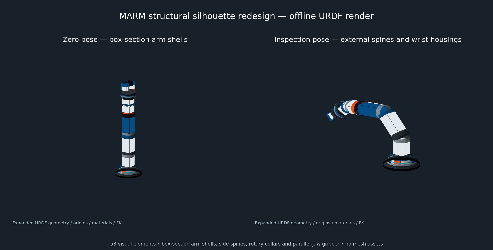

# Robot｜机械臂与 AI 视觉实验

面向机器人课程与项目实践的代码仓库，涵盖机械臂基础控制、OpenCV 图像处理、相机与手眼标定、颜色分拣、手势交互、传感器实验，以及 PyBullet 仿真和 ROS 模型可视化。

仓库按实验主题组织，包含 Python 脚本、Jupyter Notebook、模型、标定配置、课程资料和实验记录。不同模块使用各自的环境与硬件配置，请从对应入口开始。

## 从哪里开始

| 目标 | 推荐入口 |
| --- | --- |
| 无机械臂，先看动作仿真 | [PyBullet 仿真说明](arm5dof_python_pybullet/README_SIM.md) |
| 学习机械臂控制与运动学 | [机械臂实验](2.机械臂实验/) · [实机 Python SDK](arm5dof_python_uservo/) |
| 学习 OpenCV 和相机标定 | [基础图像处理](3.AI基础图像处理/) · [机械臂视觉实验](4.机械臂OpenCV视觉处理实验/) |
| 完成四色目标识别 | [实验五说明](5.目标识别/README.md) · [week5.ipynb](5.目标识别/week5.ipynb) |
| 在固定 P4 点自动分拣 | [实验六说明](5.目标识别/week6_p4/README.md) |
| 用手势发送机械臂指令 | [实验七说明](week7/README.md) |
| 用手势选色，再由 Jetson 核色抓取 | [实验八说明](5.目标识别/week8/README.md) |
| 查看 URDF / Xacro 与 RViz 模型 | [ROS 模型包](arm2026_ws/src/marm_description/README.md) · [Z1 风格模型说明](arm2026_ws/Z1风格独立模型说明.md) |

建议学习顺序：基础控制 → 图像处理 → 相机/工作台标定 → 目标识别 → 自动分拣 → 手势交互。仿真和 ROS 建模可独立学习。

## 项目内容

- **机械臂控制**：舵机通信、关节与末端控制、运动学、轨迹插值、舞蹈和色块搬运。
- **视觉处理**：摄像头取帧、HSV 颜色识别、图像滤波、目标检测与跟踪、相机标定和工作台坐标转换。
- **综合实验**：固定 P4 抓取、四色垃圾桶分拣、手势选择与确认、电脑到 Jetson 的网络指令通信。
- **仿真与建模**：PyBullet 动作演示、URDF / Xacro 描述、夹爪结构和 RViz 可视化。
- **课程扩展**：GPIO / 传感器、语音识别与合成等实验资料。

## 目录导航

| 路径 | 内容 |
| --- | --- |
| [`1.基础实验/`](1.基础实验/) | 蜂鸣器、按键、OLED、舵机控制与位置读取 |
| [`2.机械臂实验/`](2.机械臂实验/) | 机械臂运动与搬运实验 Notebook、配套 SDK |
| [`3.AI基础图像处理/`](3.AI基础图像处理/) | OpenCV 基础、摄像头、灰度/二值化、绘图、滤波等 |
| [`4.机械臂OpenCV视觉处理实验/`](4.机械臂OpenCV视觉处理实验/) | 颜色/目标识别、跟踪、相机标定、手眼标定与视觉抓取 |
| [`5.sensor传感器模块/`](5.sensor传感器模块/) | LED、光敏、超声波、编码器、陀螺仪等传感器实验 |
| [`5.目标识别/`](5.目标识别/) | 目标识别、分拣、手势综合实验，含 `week3`、`week4`、`week6_p4` 和 `week8` |
| [`week7/`](week7/) | 实验七独立运行目录，含本机识别、Jetson 接收端与模型 |
| [`6.AI听觉综合项目/`](6.AI听觉综合项目/) | 语音识别、合成、唤醒及相关示例 |
| [`arm5dof_python_uservo/`](arm5dof_python_uservo/) | 实机五自由度机械臂 Python 控制代码与配置 |
| [`arm5dof_python_pybullet/`](arm5dof_python_pybullet/) | 五自由度机械臂 PyBullet 仿真 |
| [`arm5dof_visual_grasping/`](arm5dof_visual_grasping/) | 色块检测、标定和视觉抓取模块 |
| [`arm2026_ws/`](arm2026_ws/) | ROS1 Noetic / catkin 工作空间、模型、验证结果和报告资料 |
| [`AI视觉综合项目（旧）/`](AI视觉综合项目（旧）/) | 历史综合实验，供对照参考 |

`arm2026_ws/_reference/` 为第三方参考工程，`_backup/` 为历史备份，`generated/` 为模型展开及验证产物；当前模型源码位于 `arm2026_ws/src/marm_description/`。

## 环境与依赖

| 模块 | 环境与主要依赖 |
| --- | --- |
| PyBullet 仿真 | Python、PyBullet、NumPy；见 [requirements-sim.txt](arm5dof_python_pybullet/requirements-sim.txt) |
| 实验七本机端 | Windows、64 位 Python 3.11、摄像头；见 [requirements_windows.txt](week7/requirements_windows.txt) |
| 实验八本机端 | Python 3.11、摄像头；见 [requirements_laptop.txt](5.目标识别/week8/requirements_laptop.txt) |
| Jetson 实机端 | 课程设备原有 Python / SDK 环境、摄像头与舵机串口；按子项目补充依赖 |
| ROS 模型 | ROS1 Noetic、catkin、Xacro、RViz、robot_state_publisher、joint_state_publisher_gui |
| 课程 Notebook | Jupyter / JupyterLab，以及各实验单元导入的依赖 |

仓库没有统一的全量安装命令。建议各模块使用独立虚拟环境；Jetson 沿用设备已有 SDK 环境，本机手势识别依赖不需要整套安装到 Jetson。

## 获取代码

```bash
git clone https://github.com/Frankie417/robot.git
cd robot
```

私有仓库需要先配置具有访问权限的 GitHub 凭据。已有本地副本可在对应目录更新：

```bash
git pull --ff-only
```

## 快速开始

### 1. 无硬件：PyBullet 动作仿真

以下命令在 Windows PowerShell 中执行，从仓库根目录开始：

```powershell
python -m venv .venv-arm5dof-sim
.\.venv-arm5dof-sim\Scripts\python.exe -m pip install -r arm5dof_python_pybullet/requirements-sim.txt
cd arm5dof_python_pybullet
..\.venv-arm5dof-sim\Scripts\python.exe run_real_examples_in_sim.py dance
```

将 `dance` 改为 `transport` 可查看色块搬运演示。无图形界面时可运行：

```powershell
..\.venv-arm5dof-sim\Scripts\python.exe run_real_examples_in_sim.py transport --headless
```

保留整个仓库目录结构：仿真场景会读取相邻 `arm5dof_python_uservo/config/` 的工作台配置。搬运演示使用确定性的物块绑定，不代表真实接触抓取成功率。更多参数见 [仿真说明](arm5dof_python_pybullet/README_SIM.md)。

### 2. 本机与 Jetson：实验七手势控制

本机负责摄像头和手势识别，Jetson 接收指令并调用设备 SDK。先在 Windows 本机配置环境，从仓库根目录执行：

```powershell
cd week7
py -3.11 -m venv .venv-gesture
.\.venv-gesture\Scripts\python.exe -m pip install -r requirements_windows.txt
.\.venv-gesture\Scripts\python.exe week7_gesture_control.py
```

将 `week7/gesture_usb/receiver_usb.py` 和 `arm_interrupt.py` 放入 Jetson 的同一目录，在 Jetson 终端启动接收端演练：

```bash
python3 receiver_usb.py
```

默认接收端使用 simulation 模式，不连接机械臂。本机填写 Jetson 的服务地址和终端生成的当次令牌，再进行连接。真机模式的 SDK 路径、串口和启动步骤见 [实验七说明](week7/README.md)。

### 3. ROS1 Noetic：模型可视化

在已安装 ROS1 Noetic 及上表所列 ROS 依赖的 Ubuntu 环境中，从仓库根目录执行：

```bash
source /opt/ros/noetic/setup.bash
cd arm2026_ws
catkin_make
source devel/setup.bash
roslaunch marm_description view_marm_z1_style.launch
```

原模型入口为 `view_marm.launch`，课程修改版为 `view_marm_course_variant.launch`。Z1 风格模型是独立教学模型，结构与限制见 [模型说明](arm2026_ws/Z1风格独立模型说明.md)。



*上图为 URDF 离线渲染，非实机照片或 RViz 截图。*

## 综合实验的区别

| 实验 | 运行方式 | 关键区别 |
| --- | --- | --- |
| Week5 | Jetson / 摄像头 Notebook | 识别四色、保存截图和测试记录 |
| Week6 P4 | Jetson 摄像头与机械臂 | 固定 P4 位置，颜色与位置连续稳定后触发；默认演练，真机需完成标定核查 |
| Week7 | 本机识别 + Jetson 接收 | 手势发送动作指令；Five 用于停止 |
| Week8 | 本机选色 + Jetson 核色抓取 | 1 / 2 / 3 / 5 选红 / 黄 / 绿 / 蓝，再用 OK 确认；Five 只选蓝色，使用停止按钮或 Esc 制停 |

设备默认 USB 网络地址示例为 `192.168.55.1`：JupyterLab 使用 `8888`，Week7 接收服务使用 `8765`，Week8 使用 `8766`。实际地址以设备配置为准，服务令牌每次启动后重新获取。

Week8 接收端只有真机模式；其离线测试不等于可启动的仿真服务。各实验的 ROI、坐标、姿态与桶位配置需分别核对，不能跨版本直接套用。

## 离线验证

在已安装对应模块依赖的 Python 环境中，从仓库根目录分别执行：

```bash
cd "5.目标识别/week6_p4"
python -B test_week6.py
```

```bash
cd "week7/gesture_usb"
python -B test_usb.py
```

```bash
cd "5.目标识别/week8"
python -B test_week8.py
```

三个测试集使用合成图像、模拟机械臂或本机回环 HTTP，不驱动真实机械臂。覆盖颜色检测、状态机、防重复触发、动作中断、心跳与指令校验等逻辑；真机抓取、碰撞间隙和识别准确率需现场验证。

## 实机配置与实验记录

- 运行前核对 SDK 路径、舵机串口、相机编号、ROI、坐标单位与姿态约定；关闭其他占用相机或机械臂的程序。
- 配置和示教点针对具体设备。完成现场标定、路径与夹爪检查后，再启用真机动作。
- 软件停止存在识别、通信与执行延迟，不替代设备物理急停。中断后按对应模块说明恢复。
- 截图、CSV、JSON 和动作回执用于追溯实验过程；流程返回成功不等于物块实际落入目标桶。
- 虚拟环境、缓存、Notebook 检查点和重复 ZIP 分发包由 `.gitignore` 排除。超过 GitHub 普通文件大小上限的实验视频未纳入仓库。

## 资料与来源

设备背景资料见 [DICE 白熊人工智能实训平台用户手册](DICE_白熊人工智能实训平台用户手册.pdf)。报告模板、课程材料与验证记录保存在各实验目录中。

仓库包含课程配套代码和第三方参考资料，各文件的来源及许可说明以其原始声明为准；第三方参考工程的许可证保留在对应目录。
