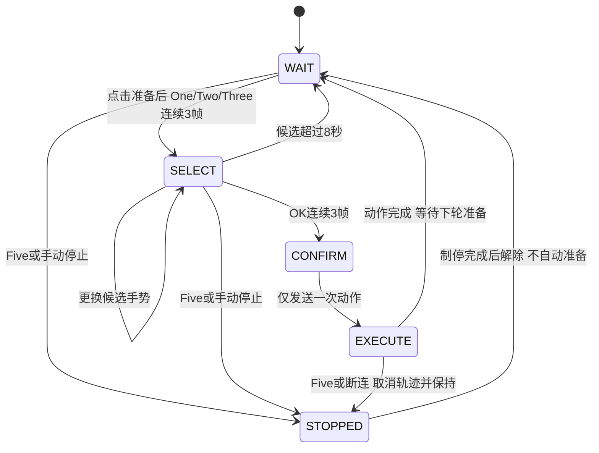

# 实验七 手势识别与机械臂指令控制

本压缩包整理了当前实验七使用的 **Micro-USB 网络版**程序、官方模型、课程资料、报告模板和已有实验截图/日志。解压后请保留整个 `week7` 文件夹结构。原始 notebook、串口旧版和虚拟环境没有打入包内，避免入口混淆和环境体积过大。

本机电脑负责拍摄并识别手势，Jetson 负责接收指令、调用实验设备已有 SDK 和控制机械臂。软件制停不等同于经过认证的硬件急停。

## 1 文件放在哪里 由谁运行

```text
week7/
  README.md                       本说明：运行方法与报告填写指导
  week7_gesture_control.py         本机 Python 总入口
  start_week7.bat                  本机双击入口
  install_windows.bat             新电脑安装 Python 依赖
  requirements_windows.txt         本机依赖版本
  requirements_jetson.txt          接收端依赖说明
  models/gesture_recognizer.task   本机预训练模型
  gesture_usb/
    app_usb.py                    本机界面、摄像头与实验取证
    recognition.py                模型推理及关键点几何规则
    control.py                    去抖、选择确认与 BUSY 状态机
    network_link.py               本机 HTTP 连接、令牌、心跳与结果查询
    receiver_usb.py               Jetson 接收服务
    arm_interrupt.py              Jetson 轨迹取消和当前位置保持
    test_usb.py                   本机自动测试，无需真实机械臂
    start_usb_gesture.bat          子目录备用入口，需包内本地环境
    results/                      已有实验日志和截图，新数据也保存到这里
  materials/                      原课程 PDF 和原 Word 报告模板
  records/
    现有记录概览.md                 从日志提取的事实与缺失项
    动作回执汇总.csv               从已有日志导出的回执，不是人工验收结果
    随机手势测试记录模板.csv        10 行待实测记录空间
  verification/                   打包后的自动测试结果
  SHA256SUMS.txt                   包中文件校验清单
```

本机不需要运行接收服务；Jetson 不需要运行摄像头识别，也不需要安装 MediaPipe。Jetson 原有机械臂 SDK 和该台设备的标定配置没有打包，以现场已有版本为准。

## 2 本机运行

### 已配置过本机环境

双击根目录 `start_week7.bat`。启动器先寻找 `week7/.venv-gesture`，其次寻找同级目录 `5.目标识别(已修改)/.venv-gesture`，再尝试系统 Python 3.11。找不到依赖时，先执行下面的安装步骤。

如果通过终端启动，进入 `week7` 根目录，使用已装好依赖的 Python 执行：

```powershell
python week7_gesture_control.py
```

### 换一台 Windows 电脑

1. 安装 64 位 Python 3.11，并确保 `py -3.11 --version` 可用。
2. 解压到可写目录，双击 `install_windows.bat`；首次安装需要网络，安装过程会新建本包内的 `.venv-gesture`。
3. 安装成功后双击 `start_week7.bat`。

手动安装等价命令：

```powershell
py -3.11 -m venv .venv-gesture
.\.venv-gesture\Scripts\python.exe -m pip install -r requirements_windows.txt
.\.venv-gesture\Scripts\python.exe week7_gesture_control.py
```

当前依赖固定 MediaPipe 0.10.21、OpenCV contrib 4.11.0.86、NumPy 1.26.4。不要另行混装 opencv-python 或 headless 版本。官方模型已打包，不需要重新下载或训练。

## 3 Jetson 运行

### 接线与访问

实验箱正常供电，用支持数据传输的 Micro-USB 线连接本机与 Jetson 的数据接口。

本机浏览器打开 `http://192.168.55.1:8888` 进入 Jetson 的 JupyterLab。浏览器虽然在本机，里面的 Terminal 和 notebook 运行于 Jetson。

8888 是 JupyterLab 端口；**8765 才是本次手势接收服务端口**。无需在本机选择 COM 口。Jetson 到舵机的内部 UART 保持原有连接。

在 Jetson 新建文件夹，把下面 **两个文件一起上传到同一个目录**：

```text
gesture_usb/receiver_usb.py
gesture_usb/arm_interrupt.py
```

在 JupyterLab 打开 Terminal，使用 `cd` 进入上传目录，再执行后面的命令。不要在 Python 的 `>>>` 提示符里输入这些终端命令。

### 第一步 先运行接收端演练

```bash
python3 receiver_usb.py
```

保持终端运行，观察它打印的 URL、TOKEN 和 `MODE: simulation`。演练模式只使用 Python 标准库，不连接机械臂。

回到本机识别窗口：

1. 点击“启动摄像头”，默认编号 0；无法取图时先关闭其他相机程序，必要时尝试编号 1。
2. 地址填写 `http://192.168.55.1:8765`。
3. 复制 Jetson 终端中 `TOKEN:` 后面的完整字符串，粘贴到“令牌”框。不要复制前缀、空格或换行，也不要粘进备注框。
4. 点击“连接并查询”，确认显示 `simulation`。
5. 收手，点击“解除停止”，再点击“准备下一条”。
6. 做 One，看到候选 One 后再做 OK；接收端演练约 2 秒。在动作期间做 Five，应显示已中断。

如果提示 `Invalid token`，说明服务已经可达，先核对令牌。每次重启接收服务都会生成新 TOKEN，必须重新复制。

### 第二步 真机模式

先关闭其他会控制同一机械臂的程序或 notebook，避免争抢舵机串口。在 Jetson 接收端终端按 Ctrl+C 停止演练，再运行：

```bash
python3 receiver_usb.py --hardware \
  --sdk-dir '/home/jetson/Notebook/4.机械臂OpenCV视觉处理实验' \
  --arm-port /dev/ttyTHS1
```

SDK 目录、机械臂内部串口和标定配置必须以现场为准。上面是已有配置对应的示例，不是自动检测结果。接收端需要原 SDK 的配套 `.py` 文件和 `config`，以及其 NumPy、pyserial 依赖；不会在初始化时自动回零。当前适配层检查六个舵机 ID 为 0..5。

如果只缺 NumPy/pyserial，可在已有 SDK 的同一 Python 环境中安装兼容版本。不要为此升级 Jetson 的整套系统环境。Python 3.6 的示例：

```bash
python3 -m pip install --user 'numpy==1.19.5' 'pyserial==3.5'
```

如已有依赖，不需要重复安装。启动报错时先保存完整错误，处理路径、依赖或设备问题后再测动作。

服务重启后，本机点击“断开/本机演练”，粘贴新 TOKEN，再连接，确认模式为 `hardware`。收手、解除停止、准备，然后先测空载夹爪张开，再闭合，最后在空间允许时测试回零。

## 4 手势怎么摆

| 手势 | 实际手形 | 作用 |
| --- | --- | --- |
| One | 只伸食指 | 选择张开夹爪 |
| Two | 食指和中指伸直 | 选择闭合夹爪 |
| Three | 食指、中指、无名指伸直，小指弯曲 | 选择回零 |
| OK | 拇指食指成环，其余三指伸直 | 确认并执行候选动作 |
| Five | 五指张开 | 中断当前动作、保持位置并锁定后续指令 |

每个手势保持约半秒至一秒，单手完整入镜。One/Two/Three 只是选择动作，必须再做 OK 才执行。每轮动作结束需重新点准备，保持 OK 不会重复执行。

Five 不需要准备或 OK，在 BUSY 中也有效。中断后先收手，再解除停止、重新准备；持续举 Five 会再次触发停止。

## 5 代码参数与状态机

| 参数 | 当前设置 | 报告解释 |
| --- | --- | --- |
| 最低识别分数 | 0.70 | 低分帧不参与指令触发 |
| 动作选择连续帧数 | 3 | 降低瞬时误识别 |
| OK 连续确认帧数 | 3 | 明确确认动作 |
| Five 连续帧数 | 2 | 优先触发停止 |
| 候选超时 | 8 秒 | 防止旧候选长期残留 |
| 图像循环调度 | 每轮结束后约 100 ms 再调用 | 不是严格 10 FPS，总周期还包括采集和推理 |
| 心跳间隔 | 约 0.25 秒 | 本机与 Jetson 持续保持连接活性 |
| 接收端心跳超时 | 约 1.5 秒，外加检查/执行延迟 | 断连后触发接收端自行制停 |
| 重复执行策略 | 每轮手动准备一次 | 不是简单的固定秒数冷却 |
| BUSY 策略 | 拒绝新动作，Five 仍有效 | 避免叠加动作 |

Three/OK 使用关键点几何规则：伸直比值 1.85、弯曲比值 1.55、OK 指尖距离/掌宽阈值 0.42。One/Two/Five 使用官方模型类别。几何分数不是分类概率，不应统一写成“概率均大于 70%”。模型最多检出两只手，检出多手时拒绝触发。

状态流程可以写入报告，也可根据下面的 Mermaid 图重画：



CONFIRM 在代码里是瞬时过渡状态，不保证画面能捕捉到它。不要伪造独立的 CONFIRM 截图。

Five 的软件制停会取消剩余轨迹，在同一个动作线程中逐个读取实际角度并覆盖原目标，然后检查新鲜角度反馈。反馈失败会锁定并报错；已收到停止请求不等于已经成功停止。真实制停延迟和残余运动应现场记录，不能用模拟测试代替。

## 6 已有证据如何使用

`gesture_usb/results/20261026_140922/` 中已有 13 张截图和事件日志。日志中有 21 条 `hardware + done` 动作回执，详情见 `records/现有记录概览.md` 和 `records/动作回执汇总.csv`。

这些日志可以证明当时接收端报告完成了对应动作流程，**不能单独证明每次真实手势正确、机械臂实际动作符合预期或识别率达到 100%**。当前没有找到 `recognition_trials.csv` 或 `command_trials.csv`；也没有找到动作最终返回 `interrupted` 的回执，不能据此写“急停验收成功”。

截图时间与动作回执时间并非一一对应，引用前应实际查看，不能把某张截图强行标成某次动作的同帧证据。演练和硬件模式记录必须分开。

新测试时：

1. 识别测试：在“真实手势”选择实际摆出的手形，点击“记录识别测试”，生成 `recognition_trials.csv` 和截图。
2. 指令测试：准备一轮，执行或中断后点击“记录本轮指令”，生成 `command_trials.csv`；备注里写实际手形、预期动作和现场观察。
3. 本轮“真实手势”下拉框用于识别记录，指令 CSV 本身没有完整的人工预期/实际动作列。把现场观察补入备注或 `records/随机手势测试记录模板.csv`。
4. 失败、未触发和误触发也要记录，不能只保留成功结果。建议至少 10 轮随机测试，并额外验证 BUSY、Five 和无手/非目标手形。

## 7 报告按模板逐项填写

打开 `materials/实验七  手势识别与机械臂指令控制.docx`，另存为自己的报告。原模板和课程 PDF 在包内保持原样。

### 封面 一 二 三

填写班级、姓名、学号、组别和实际实验日期。实验目标/重点可保留模板内容；第三部分的完成情况以真实验证为准。当前程序已实现相关逻辑，不代表随机测试、停止效果等所有验收项目都已完成。

### 4.1 手势 指令 动作映射

按本 README 的五种映射填写。模板 Fist 是建议手势，本组实际使用 Five；把该行改为 Five，并注明五指张开触发当前动作取消及保持。不要保留 Fist 却在正文写 Five。

### 4.2 识别与去抖参数

填写第 5 节的实际参数。如果现场改过阈值，使用最终代码值，并记录修改原因。分清模型分类分数和 Three/OK 的几何分数。识别调用间隔写“每轮完成后约 100 ms 调度，实际帧率随推理耗时变化”，不要直接套用旧 notebook 的 0.12 秒参数。

### 4.3 系统流程与状态图

画“本机摄像头→MediaPipe/几何规则→去抖与状态机→USB 网络 HTTP→Jetson 接收服务→原 SDK→机械臂”的系统图，再画第 5 节的状态图。说明 8888 用于 Jupyter、8765 用于接收服务，两个端口用途不同。

### 4.4 随机手势测试与误触发

用 `records/随机手势测试记录模板.csv` 记录至少 10 轮真实测试，填：实际手势序列、识别结果、预期指令、现场实际动作、成功/失败、误触发/备注和证据文件。One/Two/Three 选择加 OK 确认为一轮；Five 中断和无动作测试另注明。

如果只依据已有日志，就写“日志显示 21 条真机模式动作完成回执”，不要改写成“随机测试 21 次全部正确”。现有日志缺少对应人工真值，无法直接计算随机手势正确率。

统计公式：

- 有效测试次数 N：按事先明确规则记录的真实试验轮数。
- 正确触发次数 C：真实观察与预期动作一致的轮数，包含停止测试时应明确其判定标准。
- 正确率：C/N × 100%，N 为 0 时不计算。
- 误触发：不该执行却执行，或执行了错误动作；与“没有触发”区分开，并分别记录。

### 五 实验截图与程序说明

建议选择：五类手势标签与分数；本机连接 hardware 的状态；Jetson 接收端 hardware 状态；One/Two/Three 对应动作；EXECUTE/BUSY 互锁；Five 动作中断与最终反馈；随机测试记录。

每张图配一句实际现象说明和时间/文件名。TOKEN 只用于当前连接，提交报告截图时遮挡当次 TOKEN。不要用 simulation 截图证明真机动作，不要用静态 Five 截图证明运动已停止。

核心程序结构可按第 1 节文件职责简述，并说明 `control.py` 的单次准备/确认、`network_link.py` 的独立停止请求、`receiver_usb.py` 的执行线程/心跳、`arm_interrupt.py` 的取消事件/当前位置保持。

### 六 问题与分析 展望

按“现象→原因→修改→复测结果”写实际遇到的问题。例如本次对话确认过 `Invalid token`：服务已经可达，但令牌错误；复制接收端当次 TOKEN，重新连接。是否复测成功应依据自己的现场记录填写。

其他问题如 Three/OK 混淆、摄像头占用、SDK 路径错误，仅在确实遇到并验证过时写成实验经历。展望可以写改进关键点规则、补充复杂光照测试、测量制停延迟和增加物理停止联锁，不能写成已实现成果。

### 七 提交成果

根目录 `week7_gesture_control.py` 是本组本机总入口，具体实现位于 `gesture_usb/`，两者一起提交。附映射参数、真实测试表、截图、状态图与完成后的 Word 报告。报告应写 MediaPipe/关键点规则，不写成自行训练了 PyTorch 模型。

## 8 自动测试与故障排查

在本包根目录运行（使用已安装依赖的 Python）：

```powershell
python gesture_usb/test_usb.py
```

测试无需 Jetson、摄像头或机械臂，会使用本机回环地址创建短时 HTTP 服务。打包时测试输出位于 `verification/自动测试结果.txt`。它验证程序逻辑，不计入真实实验测试轮数。

| 现象 | 处理 |
| --- | --- |
| Invalid token | 复制当次 TOKEN，不含前缀或空白；接收端重启后重新复制 |
| 连接拒绝 | 确认 Jetson 服务保持运行、端口 8765 没被占用 |
| 连接超时 | 先确认 Micro-USB 数据线和 192.168.55.1 网络可达 |
| No module named ... | 确认本机使用包内环境；Jetson 在原 SDK 环境补缺失依赖 |
| 摄像头黑屏/无法打开 | 关闭旧识别窗口和其他摄像头程序，检查相机编号 |
| SDK/串口报错 | 核对现场 SDK 目录、内部 UART、设备供电和占用进程 |
| 无法解除停止 | 收手、等待制停结束；failed 状态必须先检查设备，不能强行续跑 |
| DISPLAY/XDG 提示但服务已打印 URL/TOKEN | 该无界面接收服务不依赖桌面显示；结合后续实际错误判断 |
